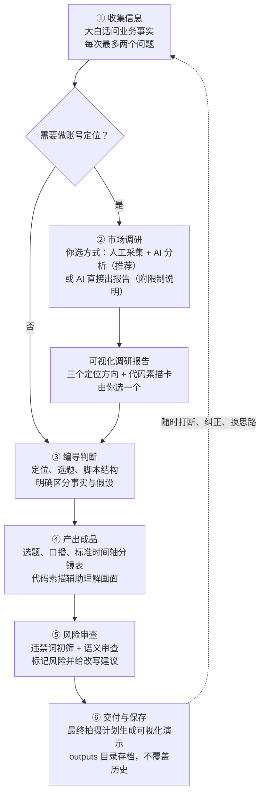

# 抖音短视频编导专家（sdskill）

一个面向零基础用户的短视频编导 Agent Skill。收集业务事实后，由智能体完成定位、选题、口播、分镜、拍摄、剪辑、发布与风险审查，并支持销售脚本、直播和付费投放规划。

## 背景

本 Skill 的方法体系基于国内头部短视频博主培训课程提炼打造，覆盖从市场调研、账号定位、选题策划、脚本写作、分镜设计到拍摄剪辑、发布运营和风险审查的完整编导链路，共 16 个方法模块、120 条可执行方法。你不需要懂编导术语，智能体会把专业判断做完，你只需要回答关于自己业务的事实问题。

## 工作流程

你和 Skill 的协作按下面的循环进行，每一轮对话只做一小步：



### 默认可视化交付

| 阶段 | 你会看到什么 | 怎么生成 |
|---|---|---|
| 市场调研 | 浏览器可翻页的调研报告 | 调用你可用的 PPT Skill；不可用时明确说明并生成单文件 HTML |
| 定位方向 | 三个方向各一张场景素描卡 | 代码绘制，体现人物、场景与内容重心差异 |
| 分镜脚本 | 每镜左侧文字表、右侧构图素描，含完整台词、情绪、景别运镜与剪辑 | 优先生成静态 HTML 表格，再用代码逐镜绘制构图，不调用视频模型 |
| 最终拍摄计划 | 可翻页的执行演示 | 调用你可用的 PPT Skill，包含安全与收工检查 |

可视化文件保存在当前任务目录，对话中先展示成品。示意图只帮助理解，不会伪造客户现场或效果数据；你的工具没有文件能力时会明确说明限制。

> 说明：违禁词初筛不能替代你最终确认平台规则；没有真实数据时，智能体不会承诺播放量或成交效果。

每一步都可以打断和纠正：信息给错了就重新回答，方向不对就直接说「换个思路」，智能体不会替你编业务事实。

## 仓库内容

```text
skills/sdskill/
├── SKILL.md                  # 触发说明与执行入口，调用名 /sdskill
├── references/
│   ├── prompts/              # 访谈、分析、主流程与合规审查
│   └── knowledge/            # 16 个按需读取的方法模块，120 条方法
├── scripts/
│   ├── check_copy.py         # 文案风险词初筛
│   ├── check_update.py       # 版本自检（对比 GitHub 最新 Release）
│   └── validate_skill.py     # Skill 完整性校验
├── data/                     # 风险词库、版本信息与维护说明
└── tests/fixtures/           # 扫描测试样例
```

公开版不包含原始文稿、逐字清洗稿或内部溯源索引。原工程中的内部验证材料不应直接上传到公开仓库。

## 安装为 Agent Skill

将整个 `skills/sdskill/` 文件夹复制到你使用的 AI 工具的 Skills 目录，或导入发布包中的 `sdskill.skill`。不同工具的目录和导入入口可能不同，以对应版本的说明为准。

在 Kimi Work 等支持斜杠技能命令的 AI 工具中，安装后新开对话输入 `/sdskill` 即可调用；当前会话若未刷新技能索引，请重启或新开对话。

### 版本更新

Skill 会在每次新会话开始时自动检查一次更新（默认每 14 天向 GitHub 请求一次，见 `data/version.json`）。发现新版本时，对话中会提示新版本号和更新方法。手动更新：

```powershell
# Windows PowerShell：下载最新包并覆盖 Skills 目录中的 sdskill 文件夹
iwr -Uri "https://github.com/Ford-Z15/sdskill/releases/latest/download/sdskill.skill" -OutFile "$env:TEMP\sdskill.zip"
Expand-Archive "$env:TEMP\sdskill.zip" -DestinationPath "<你的Skills目录>\sdskill" -Force
```

```bash
# macOS / Linux
curl -L -o /tmp/sdskill.zip https://github.com/Ford-Z15/sdskill/releases/latest/download/sdskill.skill
unzip -o /tmp/sdskill.zip -d ~/.claude/skills/sdskill
```

也可以在 [Releases 页面](https://github.com/Ford-Z15/sdskill/releases)手动下载，或 Watch 仓库选 Releases only 接收发版邮件通知。

安装后可直接提出：

- `/sdskill 帮我为一家社区宠物店写第一条视频，只能用手机拍。`
- “把这段口播改得自然一些，并补上分镜和剪辑要求。”
- “根据这些真实后台数据，帮我复盘下一条应该怎么改。”

## 在 WorkBuddy 中使用

支持 Agent Skills 的版本可按其技能入口导入本 Skill。

如果当前版本不支持技能导入：

1. 将 `sdskill/` 文件夹完整复制到工作目录。
2. 把 `SKILL.md` 的内容放入智能体自定义指令，或作为新对话的首条指令。
3. 确保智能体能读取同目录下的 `references/`、`data/` 和 `scripts/`。
4. 没有文件能力时仍可生成对话成品，但不得声称已经保存文件。

## 在 Claude / Codex 中使用

**方式一：直接发给 AI 一行指令（最简单）**

新开对话，把下面这段原样发给 Claude 或 Codex：

```text
请从 GitHub 仓库 https://github.com/Ford-Z15/sdskill 获取 skills/sdskill 目录的全部文件到当前工作目录，阅读其中的 SKILL.md 并严格按照它作为「抖音短视频编导专家」（调用名 /sdskill）技能与我协作。
```

AI 会自己完成下载和读取，之后直接用大白话提需求即可。

**方式二：命令行安装（Claude Code 用户）**

一行命令装到 Claude Code 技能目录：

```bash
mkdir -p ~/.claude/skills && git clone --depth 1 https://github.com/Ford-Z15/sdskill.git /tmp/dsv && cp -r /tmp/dsv/skills/sdskill ~/.claude/skills/ && rm -rf /tmp/dsv
```

Windows（PowerShell）：

```powershell
git clone --depth 1 https://github.com/Ford-Z15/sdskill.git $env:TEMP\dsv; Copy-Item -Recurse $env:TEMP\dsv\skills\sdskill $HOME\.claude\skills\; Remove-Item -Recurse $env:TEMP\dsv
```

装好后重启会话，技能自动生效。

**方式三：手动安装**

下载 Release 中的 `sdskill.skill` 或仓库 `skills/sdskill/` 文件夹，解压后放到你使用的 AI 工具支持的技能目录，或将 `SKILL.md` 全文粘贴为自定义指令。

## 本地验证

在 `skills/sdskill/` 目录运行：

```bash
python scripts/validate_skill.py
python scripts/check_copy.py tests/fixtures/compliance_sample.txt
```

词库扫描仅用于初筛，不能替代语义、事实、证据和当前平台规则审查。

## 发布前检查

- 每次同步更新必须在 `CHANGELOG.md` 补充说明；涉及功能变化时同步发布新版本 Release。

- 确认你拥有公开这些方法、文案和词库内容的权利。
- 不上传原始培训文稿、用户资料、账号数据或任务成品。
- 当前未指定开源许可证；公开仓库不等于授权他人自由复制或再发布。需要开放使用时，请由仓库所有者明确选择许可证。
